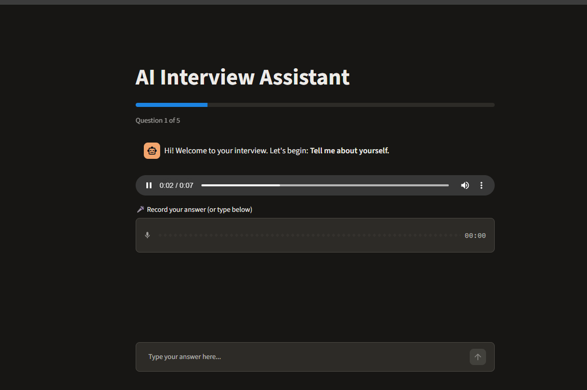
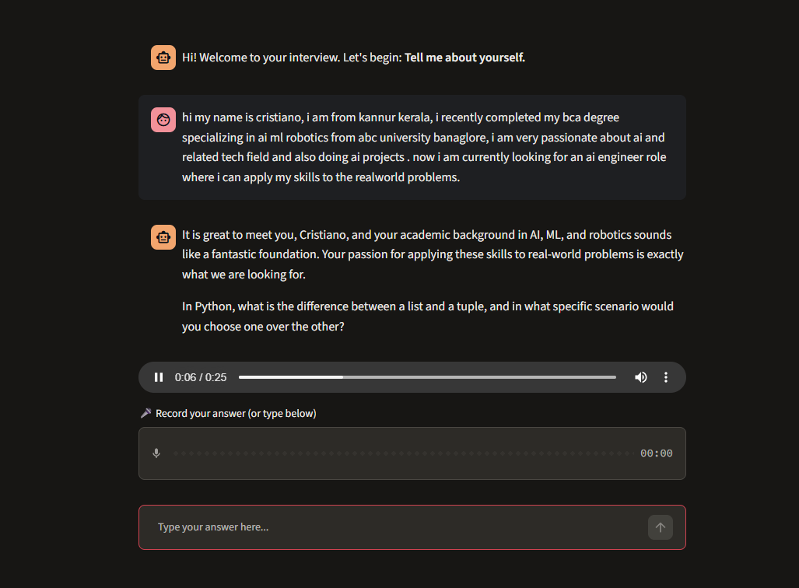
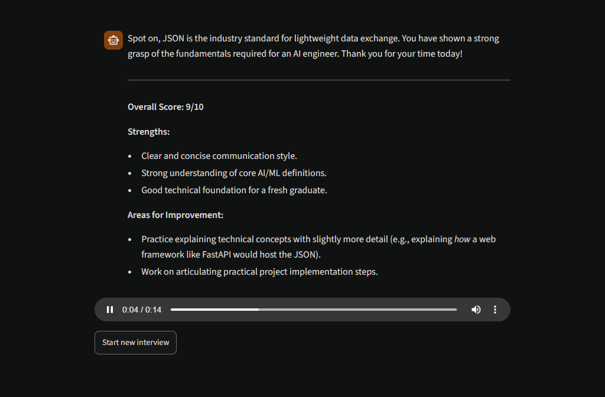

# 🎤 AI Interview Assistant

🔗 **Live demo:** [Try it here](https://ai-interview-assistant-efrb7mraemz444ggygnwt7.streamlit.app)

A voice-enabled mock interview app for **any job role**. Choose a role and a difficulty
level, and the AI interviewer asks role-specific questions out loud. You answer by
speaking or typing, get feedback after every answer, and receive a final score at the end.

> 💡 Voice input needs microphone permission in your browser. You can also type your answers.

## Features
- Choose any job role (Data Analyst, Web Developer, Accountant, ...) and a difficulty level
- AI plans interview topics for the chosen role and asks one question at a time
- Voice input: speak your answer (speech-to-text with Gemini)
- Voice output: the interviewer speaks in a natural voice (edge-tts, with gTTS as backup)
- Instant feedback after each answer, plus a final score out of 10 with strengths and improvements
- Automatic retry and backup model when the API is busy

## Screenshots

### Start screen

### Interview in progress

### Final result

## Tech Stack
Python, Streamlit, Google Gemini API, edge-tts, gTTS

## How It Works
1. The user enters a job role and difficulty level.
2. Gemini plans 4 interview topics for that role.
3. The interviewer asks one question at a time. The user answers by voice or text.
4. Each answer is sent to Gemini with the full conversation history, and the AI gives
   short feedback and the next question.
5. After the last answer, the app shows a score out of 10 with strengths and improvements.

## Deployment
Deployed on Streamlit Community Cloud. The Gemini API key is stored in Streamlit Secrets.

## How to Run Locally
1. Clone the repo

        git clone https://github.com/Shobhish/AI-Interview-Assistant.git
        cd AI-Interview-Assistant

2. Create a virtual environment and install packages

        python -m venv venv
        venv\Scripts\activate
        pip install -r requirements.txt

3. Create a `.env` file and add your Gemini API key

        GEMINI_API_KEY=your_key_here

4. Run the app

        streamlit run app.py

## Customize
Edit the `LEVELS` dictionary in `app.py` to change how hard the questions are.

## Future Improvements
- Upload a resume for personalized questions
- Save interview history and scores
- Downloadable feedback report